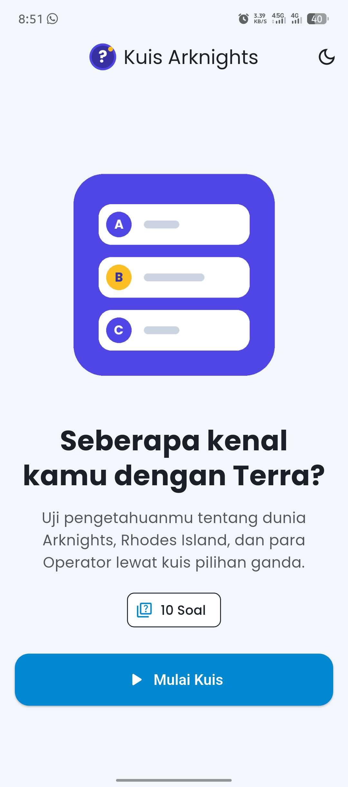
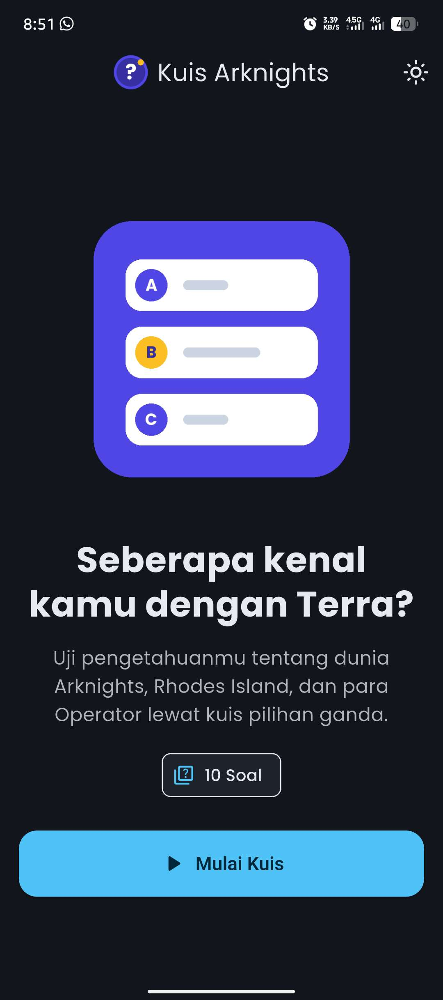
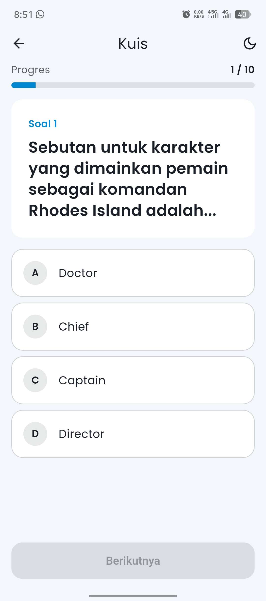
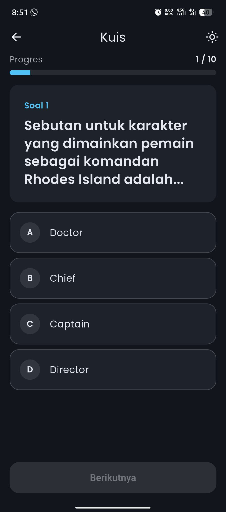
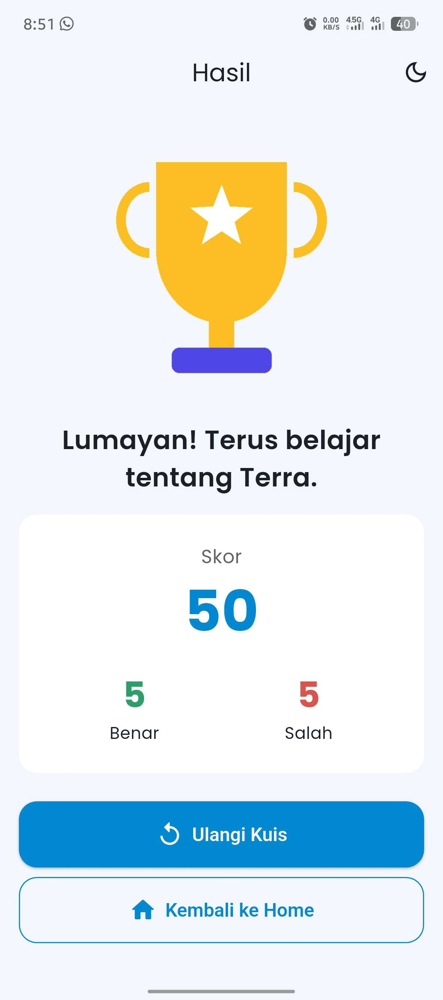
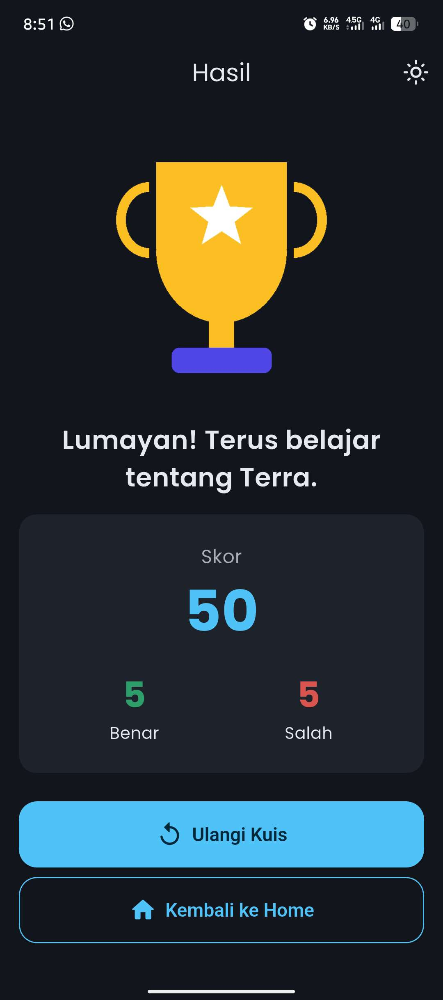
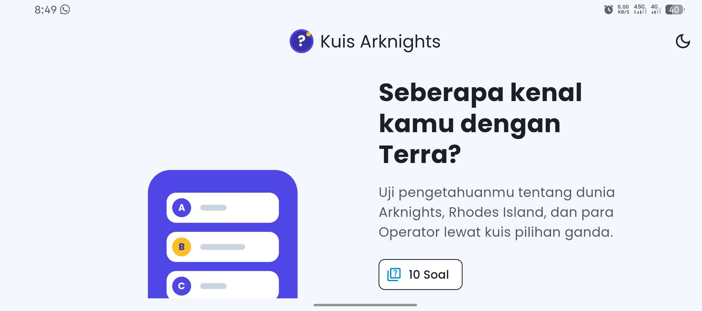
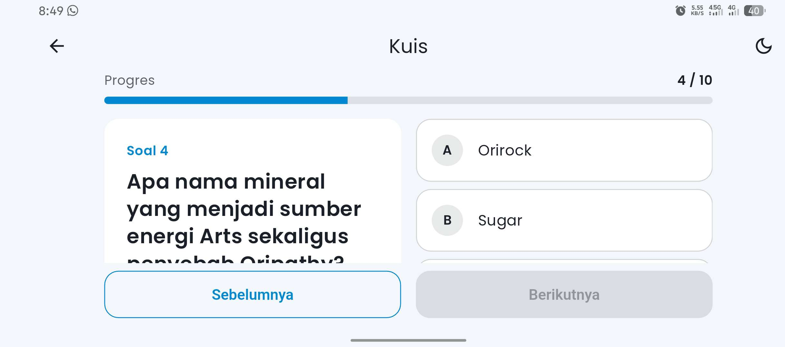
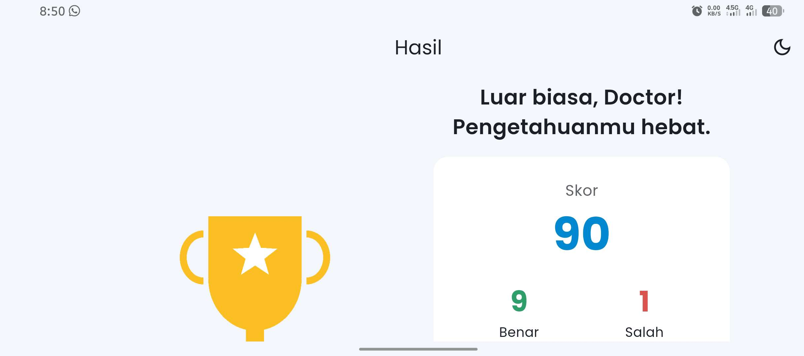

# Kuis Arknights

Aplikasi kuis pilihan ganda bertema game Arknights, dibuat dengan Flutter untuk UTS Pemrograman Mobile 1.

---

## A. Identitas Mahasiswa

| | |
|---|---|
| **Nama** | FATIH DWI ANGGORO |
| **NIM** | 241401004 |
| **Lab.** | PEMROGRAMAN MOBILE 1 |

---

## B. Informasi Aplikasi

### Nama Aplikasi
**Kuis Arknights**

### Deskripsi Singkat
Aplikasi kuis 10 soal pilihan ganda seputar dunia Arknights (Rhodes Island, Operator, dan Terra). Pengguna menjawab soal satu per satu, melihat umpan balik benar/salah, lalu mendapat skor akhir. Data soal disimpan lokal tanpa database.

### Fitur
- **Kuis 10 soal** pilihan ganda dengan indikator progres.
- **Umpan balik langsung**: jawaban benar hijau, jawaban salah merah.
- **Navigasi soal** sebelumnya/berikutnya; jawaban tersimpan per soal.
- **Halaman hasil**: skor, jumlah benar/salah, dan pesan sesuai skor.
- **Lanjutkan kuis**: progres tidak hilang saat rotasi layar, pindah halaman, atau ganti tema.
- **Konfirmasi keluar** saat menekan tombol back di tengah kuis.
- **Tema terang & gelap** (default mengikuti sistem) dengan tombol toggle.
- **Responsif & adaptif**: tampilan satu kolom di HP portrait, dua kolom di landscape/tablet/web, dengan lebar konten dibatasi.
- **Font kustom** Poppins dan aset gambar/ikon lokal.

### Teknologi & Struktur

- Flutter + [`provider`](https://pub.dev/packages/provider) (`ChangeNotifier`) untuk state management.
- Provider diletakkan di atas `MaterialApp` sehingga state tahan rotasi dan perpindahan halaman.

```
lib/
├── main.dart                 # titik masuk aplikasi
├── app.dart                  # MultiProvider + MaterialApp
├── core/
│   ├── router/               # AppRoutes & onGenerateRoute
│   ├── theme/                # warna & ThemeData light/dark
│   ├── constants/            # path aset & teks statis
│   └── utils/                # helper Responsive
├── data/                     # model Question & 10 soal dummy
├── providers/                # QuizProvider, ThemeProvider
├── screens/                  # Home, Quiz, Result
└── widgets/                  # reusable widget (1 widget = 1 file)
```

### Cara Menjalankan

```bash
flutter pub get
flutter run            # pilih perangkat/emulator
flutter run -d chrome  # versi web
flutter test           # menjalankan pengujian
```

---

## C. Dokumentasi

### Credit Aset

| Aset | Sumber |
|---|---|
| Font **Poppins** (Regular, Medium, SemiBold, Bold) | [Google Fonts](https://fonts.google.com/specimen/Poppins), lisensi SIL Open Font License 1.1 |
| Gambar & ikon (`assets/images`, `assets/icons`) | Dibuat sendiri untuk proyek ini (di-generate dengan skrip Python) |
| Tema & materi soal | Terinspirasi game **Arknights** (© Hypergryph / Yostar). Aplikasi ini proyek tugas kuliah dan tidak berafiliasi dengan pihak tersebut |
| Package `provider` | [pub.dev/packages/provider](https://pub.dev/packages/provider) oleh Remi Rousselet |
| Ikon Material (toggle tema, tombol) | [Material Icons](https://fonts.google.com/icons), Apache License 2.0 |

### Screenshot

| Halaman | Light | Dark |
|---|---|---|
| Home |  |  |
| Kuis |  |  |
| Hasil |  |  |

Tampilan landscape/tablet/web:

| Home (landscape) | Kuis (landscape) | Hasil (landscape) |
|---|---|---|
|  |  |  |

### Mockup / Prototype
[Lihat mockup di Canva](https://canva.link/2z72hyauu28hesr)

### Video Presentasi
[Lihat video presentasi di Google Drive](https://drive.google.com/drive/folders/1Zxs_CCprmDKIdiruZzglBnjs_Mz3YLyF?usp=sharing)
